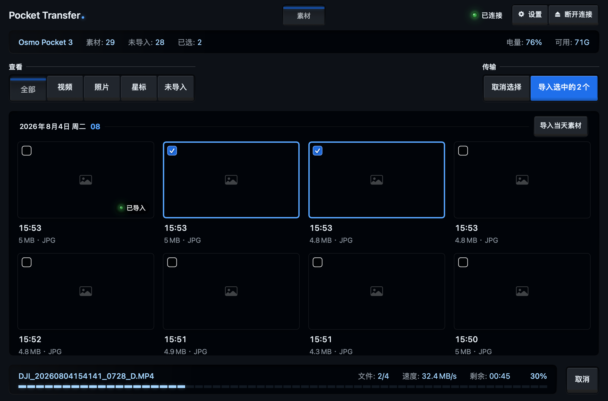

# Pocket Transfer

**把Pocket相机素材直接导入Mac，无需每次拔卡。**

基于[Osmotic](https://github.com/smithplus/Osmotic)二次开发。原作made by [smithplus](https://smithplus.me)，本分支由[hotpotly](https://github.com/hotpotly)维护。非大疆官方软件，与DJI无隶属或背书关系。

[下载macOS预览版](https://github.com/hotpotly/PocketTransfer/releases/tag/v0.3.0) · [中文使用说明书](docs/USER_GUIDE.zh-CN.md) · [编译指南](docs/BUILD.md) · [问题反馈](https://github.com/hotpotly/PocketTransfer/issues)




## 能做什么

- **无线导入**：蓝牙发现、配对，切换到相机Wi-Fi读取原始视频、照片和配套文件。
- **USB-C导入**：读取以文件传输模式挂载的相机存储，也支持读卡器和手动选择DCIM目录。
- **选择保存文件夹**：每批手动导入前选择目录，可按拍摄日期归档。
- **导入新增素材**：记录已导入文件，保留相机原文件；冲突时报错，不覆盖已有的不同文件。
- **相机提醒**：已配对相机被发现时发送Mac通知，点击后连接并导入新增素材到上次选择的文件夹。
- **菜单栏常驻**：关窗口不退出；完全退出后不再扫描。不会自动添加开机启动项。
- **深色中文界面**：放大字号，支持缩略图、预览、筛选和传输进度。

音频随原视频保留；相机生成配套WAV时可一起导入。**不单独提取视频音轨，不读取DJI Mic发射器内部录音。**

## 安装与开始使用

1. 下载Release中的`Pocket-Transfer-0.3.0-macOS-arm64.zip`，不是GitHub自动生成的“Source code”。
2. 解压，将`Pocket Transfer.app`拖到“应用程序”，然后打开。
3. 首次连接按需允许蓝牙、本地网络、定位、通知及目录访问；在相机屏幕确认配对。
4. 选择素材，点击“导入所选”或“导入新增”，选择保存文件夹。
5. 用完点击“断开连接”；可在设置中启用手动导入完成后自动断开。

**要求：Apple芯片Mac、macOS 15或更高版本。此安装包仅提供arm64。**

**这是个人维护的预览版：仅本地签名，未经过Apple Developer ID签名或公证。macOS可能阻止启动。** 不要全局关闭系统安全保护；请先审查来源、校验下载文件，必要时自行编译。有关安全提示，见[Apple说明](https://support.apple.com/zh-cn/102445)。

## 相机兼容性与验证状态

| 设备或场景 | 当前状态 |
|---|---|
| Osmo Pocket 3 | 源码沿用上游已实机验证的导入协议；本分支完整流程未重新实机验证 |
| Osmo Pocket 4 Pro | 定制早期版本有实机配对、列出素材及视频下载成功记录；当前公开版需进一步复测 |
| Osmo Pocket 4 | 有协议支持，未独立实机验证 |
| 读卡器 | 已验证识别与导入流程；不等同于相机USB-C直连实测 |
| 相机USB-C直连 | 需能挂载为存储卷；当前相机端到端兼容性未全面验证 |
| 相机通知→点击→自动导入 | 通知送达与策略测试通过；完整实机流程仍需复测 |
| Sony相机 | 不支持；未实现Sony FTP或其他协议 |

不承诺固定无线速度。距离、干扰、相机型号、文件大小和存储介质都会影响速度。先用少量素材验证，并保留原卡备份。

## Wi-Fi与VPN

无线传输会临时占用Mac的Wi-Fi连接，因此原Wi-Fi的互联网连接会中断。断开后App尝试恢复普通Wi-Fi。

联网检测沿用系统VPN和代理；已经连接普通Wi-Fi时，不会因联网检测失败而反复断开。App不修改Shadowrocket、DNS或系统代理设置。**这不保证所有路由器、VPN和系统版本组合都能自动恢复。** 详见[故障排查](docs/USER_GUIDE.zh-CN.md#故障排查)。

## 数据与隐私

- 默认素材目录：`~/Downloads/Pocket Transfer/`。
- 导入记录、缩略图和日志：`~/Library/Application Support/Pocket Transfer/`。
- 偏好及配对记录：本机UserDefaults；手动输入的相机密码按需存入钥匙串。
- 无账号、无遥测、无素材上传服务。联网检测会向`www.apple.com`发送HTTPS HEAD请求。
- 自动更新已关闭，请从本仓库Release手动更新。
- 安装包不包含开发者的素材、日志、配对信息、Wi-Fi密码或本机工作目录。

详见[安全与隐私说明](SECURITY.md)。

## 开发与测试

```bash
git clone https://github.com/hotpotly/PocketTransfer.git
cd PocketTransfer
swift test
./scripts/package_public.sh
open "dist/Pocket Transfer.app"
```

需要macOS、Swift 6.1或以上、可用的macOS SDK、Python 3。打包脚本只生成当前Mac架构的版本。详见[编译指南](docs/BUILD.md)。

## 开源来源与许可证

本项目是Osmotic的定制分支，**并非从零实现相机协议**。公开仓库以经过隐私筛选的源码快照起步，不包含私人开发历史和运行数据。

- [Osmotic](https://github.com/smithplus/Osmotic)：原生Mac客户端，原作者[smithplus](https://smithplus.me)，MIT。
- [Osmosis](https://github.com/KonradIT/osmosis)：Konrad Iturbe的协议和文件列表解码器，MIT。
- [Kaze for DJI](https://github.com/brianmerchant/Kaze-for-DJI)：Brian Merchant的控制和实时画面相关实现，MIT；本分支不开放这些界面入口。
- [OpenPocketCine](https://github.com/erik-sutton95/OpenPocketCine)：控制与实时画面研究文档，Apache-2.0；上游按文档重新实现。
- 其他协议研究者、测试贡献者保留在App“设置→开源致谢”中。

保留原项目版权声明，采用[MIT许可证](LICENSE)。支持原作者：[Buy me a coffee](https://buymeacoffee.com/smithplus)。DJI、Osmo等商标归各自所有者所有。截图仅为模拟数据。
